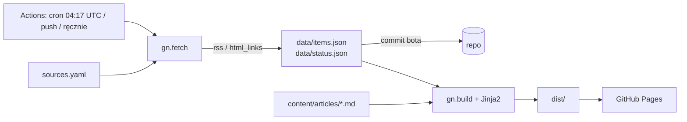

# 01 – Architektura (demo na GitHubie)

## Przepływ dzienny
1. `gn.fetch` czyta `sources.yaml` i dla każdego źródła wywołuje adapter.
2. Z jednego źródła bierze maks. 30 najnowszych wpisów; deduplikacja po `id` (SHA-1 z URL) oraz po parze (źródło, tytuł).
3. Istniejące wpisy nie są nadpisywane. Plik trzyma maks. 600 wpisów.
4. Bot commituje `data/`; push tokenem `GITHUB_TOKEN` nie uruchamia kolejnego workflow.
5. `gn.build` generuje `dist/` i wdraża na Pages.

## Model wpisu (`data/items.json`)
| Pole | Opis |
|---|---|
| `id` | 16 znaków SHA-1 z URL |
| `source`, `source_name` | identyfikator i nazwa źródła |
| `category` | slug kategorii z `site.yaml` |
| `title`, `lead` | tytuł i zajawka (≤220 znaków) |
| `url` | link do oryginału |
| `published` | data ISO; gdy strona jej nie podaje – data pobrania |
| `fetched_at` | czas pobrania (UTC) |
| `event_date` | tylko wydarzenia: `RRRR-MM-DD GG:MM:SS`; `00:00:00` = cały dzień |

## Adaptery
- **`rss`** – RSS/Atom przez `feedparser`; opcja `fallback_urls` na wypadek pustej odpowiedzi.
- **`tribe_events`** – kalendarz „The Events Calendar” przez REST API (`/wp-json/tribe/events/v1/events`).
  Wpisy dostają `event_date`; przy kolejnych pobraniach termin, tytuł i opis są odświeżane.
- **`html_links`** – bez selektorów CSS: zbiera linki pasujące do `link_pattern`, a tytuł, datę
  (`DD.MM.RRRR` lub `RRRR-MM-DD`) i lead bierze z najbliższego kontenera zawierającego tylko ten wpis.
  Odporny na zmiany klas; zawodzi, gdy lista nie ma linków z unikalnym wzorcem URL.
  Opcje: `strip` (regexy wycinane z tytułu i leadu), `require_date` (pomija linki bez daty, np. menu).

## Strony w `dist/`
`/` · `/wydarzenia/` · `/kategoria/{slug}/` · `/artykul/{slug}/` · `/rozrywka/` · `/zrodla/` · `search.json`

## Wydarzenia
Wpisy z `event_date` nie trafiają do strumienia wiadomości. Generator pokazuje tylko nadchodzące
(od dnia budowy), od najbliższego: dwa pierwsze w „… dziś”, kolejne w sekcji „Najbliższe wydarzenia”
i komplet na `/wydarzenia/`.

## Miniatury ze źródeł
Włączane w `site.yaml` kluczem `source_images: true` (Grodzisk tak, Boppard nie – tam wymagałoby to zgody źródeł).
Adres miniatury bierzemy z kanału RSS, a gdy go tam nie ma – z nagłówka `og:image` strony artykułu
(`gn.fetch.add_images`: najwyżej 40 stron na przebieg, każdy wpis sprawdzany raz). Zapisujemy tylko adres;
plik zostaje na serwerze źródła i stamtąd jest wyświetlany (`referrerpolicy="no-referrer"`). Gdy obraz się nie
wczyta, karta wraca do pastelowego kafelka kategorii. Ten sam obraz przy więcej niż dwóch wpisach jednego źródła
uznajemy za logo i pomijamy. Wydarzenia zachowują kafelek z datą.

## Ilustracje tematyczne i układ strony głównej
Wpis bez zdjęcia dostaje ilustrację dobraną po tytule: `i18n/<lang>.yaml` → `topics` (temat → wyrażenie regularne,
kolejność = pierwszeństwo), pliki w `static/img/topics/<temat>.svg` (17 tematów, własne rysunki). Bez dopasowania
zostaje pastelowy kafelek kategorii. Sekcja „Najważniejsze”: dwie duże karty + zwarta lista sześciu wpisów;
reklama (jeśli włączona) jako pasek pod sekcją. Wydarzenia o tym samym tytule i terminie z jednego źródła są scalane.

## Strona główna jako całość
Kolejność: główny blok + „dziś” → „Najważniejsze” (+ reklama) → sekcje kategorii (po 8 najnowszych wpisów, link
„Zobacz wszystkie” do podstrony, gdy jest ich więcej) → „Przydatne” → kontakt → wydarzenia (8 najbliższych) na końcu.
Menu i dolny pasek prowadzą do kotwic `#<slug>` na stronie głównej (z podstron: `../../#<slug>`); kategoria bez
wpisów zachowuje link do własnej podstrony. Podstrony kategorii i `/wydarzenia/` nadal istnieją jako pełne listy.

## Panel redakcji
`admin/index.html` ładuje Sveltia CMS (wersja przypięta, z unpkg), `admin/config.yml` opisuje kolekcję
`content/articles` (pola zgodne z nagłówkiem YAML czytanym przez `gn/build.py`). Logowanie: token GitHuba
(fine-grained, Contents: Read and write, tylko to repo). Zapis = commit na `main` = przebudowa.
Workflow robi `git pull --rebase` przed wypchnięciem danych, żeby nie kolidować z commitami z panelu.

## Krzyżówki
Pliki `content/krzyzowki/*.html` są samodzielnymi stronami (własny CSS i JS). `gn/build.py` kopiuje je do
`dist/rozrywka/krzyzowki/{slug}/index.html`, dokleja pasek powrotu i listuje na `/rozrywka/`.

## Sudoku dnia
`gn/sudoku.py` generuje przy każdym buildzie trzy plansze (łatwe 40, średnie 33, trudne 28 podanych cyfr)
z seedem `data:poziom`, więc w danym dniu plansze są stałe. Każda ma dokładnie jedno rozwiązanie
(sprawdzane solverem). Gra działa w przeglądarce (`static/sudoku.js`), postęp zapisuje się w `localStorage`.

## Ograniczenia wersji demo
- Adaptery są przetestowane na próbkach offline; pierwszy przebieg na żywych stronach następuje w Actions.
- Cron w Actions bywa opóźniony; harmonogram wyłącza się po 60 dniach bez aktywności w repo.
- Pogoda (Open-Meteo) i wyszukiwarka działają w przeglądarce; brak newslettera i formularzy.
- Policja (KSP) nie jest podłączona: strona z filtrem jednostki nie dała się odczytać – do ustalenia adres.
