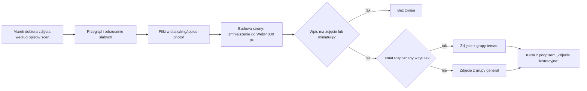

# Pula zdjęć ilustracyjnych — instrukcja i opisy scen (2026-11-22)

> **Aktualizacja 22.11.2026:** pula powstała ze zdjęć z Pixabay, a nie z generatora AI (decyzja Marka).
> Dlatego podpis na kartach brzmi „Zdjęcie ilustracyjne” (Boppard: „Symbolbild”), a nie „Ilustracja AI”.
> Stan: 94 zdjęcia po przeglądzie (z 108 odrzucono 14: rozpoznawalne miejsca, logo, okładki, dzieła sztuki,
> dziecko, barwy narodowe); lista źródeł i autorów w `zrodla.csv` obok zdjęć. Licencja Pixabay nie wymaga
> podpisu autora, ale nie obejmuje praw osób trzecich (marki, dzieła, wizerunek) – stąd zasady treści poniżej.
> Słabsze grupy do uzupełnienia: `general` i `council` (po 4 zdjęcia). Zdjęcia mają 640×400 px – na dużych
> kartach będą nieostre; docelowo pobrać wersje 1280 px. Opisy scen poniżej służą jako wzorzec doboru zdjęć
> (albo prompty, gdyby pula była kiedyś generowana).

Wariant 1 z `08-ilustracje-ai-architektura.md`: jednorazowo wygenerowana pula fotorealistycznych zdjęć
tematycznych, wspólna dla serwisów Grodzisk, Saska Kępa i Boppard. Zdjęcie z puli pojawia się na karcie
wpisu **tylko wtedy, gdy wpis nie ma własnego zdjęcia ani miniatury ze źródła**, i zawsze z podpisem „Zdjęcie ilustracyjne”.

## Jak to działa



- Temat wybierają te same słowa-klucze co dotąd (`i18n/pl.yaml`, `i18n/de.yaml` → `topics`).
- Dla danego wpisu zawsze wychodzi to samo zdjęcie z grupy; różne wpisy dostają różne ujęcia.
- Brak plików dla tematu i brak grupy `general` → zostaje rysowana ilustracja SVG jak dziś. Pulę można więc wgrywać partiami.
- Wydarzenia zachowują kafelek z datą.
- Strona `/zrodla/` pokazuje pod tabelą liczbę plików w każdej grupie.

## Zasady plików

| Zasada | Wartość |
|---|---|
| Folder w repo | `static/img/topics-photo/` |
| Nazwa | `<temat>-<numer>.jpg`, np. `road-1.jpg`, `general-4.jpg` (także `.jpeg`, `.png`, `.webp`) |
| Temat w nazwie | dokładnie jedna z 18 nazw z tabel poniżej, małymi literami |
| Proporcje | poziome 16:9 (karta przycina środek kadru) |
| Rozmiar | szerokość 1200–1600 px, JPG, najlepiej poniżej 500 KB — strona i tak zmniejsza do 800 px |
| Liczba | po 6 na temat = 108 plików; można mniej lub więcej |

## Zasady treści (odrzucaj obrazy, które je łamią)

- Bez napisów, liter, tablic z tekstem, logo, herbów i flag — także zniekształconych.
- Bez rozpoznawalnych twarzy; ludzie najwyżej z daleka, od tyłu lub nieostro.
- Bez mundurów z oznaczeniami, radiowozów i wozów z napisami.
- Bez scen zdarzeń (wypadek, pożar budynku, zatrzymanie) — tylko przedmioty i miejsca.
- Bez znanych, rozpoznawalnych budynków: obraz nie może udawać konkretnego miejsca w mieście.
- Odrzucaj typowe błędy generatorów: zdeformowane dłonie, bezsensowne znaki drogowe, „roztopione” detale.

## Prompt

Wklej stały początek, potem scenę z tabeli, potem stałe zakończenie.

**Początek:**
`Photorealistic editorial stock photograph of`

**Zakończenie:**
`Small Central European town setting, natural light, 35mm lens, shallow depth of field, muted natural colours, landscape format 16:9. No text, no letters, no signs with writing, no logos, no flags, no recognizable faces, no uniforms with insignia.`

## Sceny

### road — drogi, remonty, utrudnienia
| Plik | Scena |
|---|---|
| road-1 | orange traffic cones lined up on a freshly paved asphalt street |
| road-2 | a road roller compacting new asphalt on a residential street, steam rising |
| road-3 | a workers' shovel and stacked paving stones beside a half-finished pavement |
| road-4 | an excavator bucket next to a trench on a closed street, red-white barrier tape |
| road-5 | wet cobblestone street at dusk with blurred car lights |
| road-6 | an empty roundabout with trees in early morning light, seen from the roadside |

### bus — autobusy, komunikacja
| Plik | Scena |
|---|---|
| bus-1 | an empty modern glass bus shelter with a bench on a quiet street |
| bus-2 | rows of empty seats and yellow handrails inside a modern city bus |
| bus-3 | the side of a city bus passing by with motion blur, no markings |
| bus-4 | a hand holding a handrail inside a bus, blurred windows behind |
| bus-5 | a bus bay with yellow road markings seen from above, no vehicles |
| bus-6 | bus doors open at a stop on a rainy evening, warm interior light, no people |

### train — kolej
| Plik | Scena |
|---|---|
| train-1 | railway tracks curving into the distance between trees at golden hour |
| train-2 | an empty small-town railway platform with a bench and a lamp post |
| train-3 | rows of empty seats inside a modern commuter train, window light |
| train-4 | a close-up of steel rails and gravel ballast |
| train-5 | a level crossing with raised barriers on a country road, no vehicles |
| train-6 | a commuter train front approaching a platform, blurred, no markings |

### stage — koncerty, teatr, wystawy
| Plik | Scena |
|---|---|
| stage-1 | a microphone on a stand on an empty stage with warm spotlights behind |
| stage-2 | red theatre curtains and wooden stage floor lit by a single spotlight |
| stage-3 | hands playing a grand piano, close-up of the keys |
| stage-4 | a white gallery wall with abstract framed paintings and a wooden bench |
| stage-5 | rows of empty red theatre seats seen from the stage |
| stage-6 | a violin and sheet-music stand in a rehearsal room, the pages out of focus |

### cinema — kino, film
| Plik | Scena |
|---|---|
| cinema-1 | a beam of projector light cutting through a dark cinema hall |
| cinema-2 | rows of empty cinema seats facing a glowing blank white screen |
| cinema-3 | a bucket of popcorn on a cinema armrest in dim light |
| cinema-4 | a vintage film projector with reels, close-up |
| cinema-5 | the dim aisle of a small cinema with floor lights |
| cinema-6 | a film clapperboard with a blank slate lying on a wooden table |

### library — biblioteka, książki
| Plik | Scena |
|---|---|
| library-1 | tall wooden bookshelves in a quiet library aisle, book spines blurred |
| library-2 | an open book on a wooden reading table by a window, the page text out of focus |
| library-3 | a stack of hardcover books with blank covers next to a cup of tea |
| library-4 | a cosy reading corner with an armchair and a floor lamp among shelves |
| library-5 | a hand taking a book from a shelf, close-up, no titles visible |
| library-6 | colourful children's picture books with blank covers in a low wooden box |

### school — szkoły, przedszkola, edukacja
| Plik | Scena |
|---|---|
| school-1 | an empty bright classroom with wooden desks and a clean green chalkboard |
| school-2 | coloured pencils and an open blank notebook on a desk |
| school-3 | a row of school backpacks hanging on hooks in a corridor |
| school-4 | an empty school corridor with lockers and sunlight from large windows |
| school-5 | wooden building blocks and toys on a kindergarten carpet |
| school-6 | an empty school playground with a basketball hoop in morning light |

### health — zdrowie, szpital, badania
| Plik | Scena |
|---|---|
| health-1 | a stethoscope lying on a white desk next to a blank clipboard |
| health-2 | an empty bright clinic corridor with chairs along the wall |
| health-3 | a blood-pressure monitor cuff on a table in a doctor's office |
| health-4 | medical gloves and a sealed syringe on a sterile tray, close-up |
| health-5 | an empty hospital bed with white sheets by a window |
| health-6 | a first-aid kit with a plain cover, without any cross or symbol, on a wooden table |

### waste — odpady, segregacja
| Plik | Scena |
|---|---|
| waste-1 | a row of colour-coded recycling bins (yellow, blue, green, brown) by a fence |
| waste-2 | the rear of a garbage truck lifting a bin, no markings, motion blur |
| waste-3 | flattened cardboard and glass bottles sorted into separate crates |
| waste-4 | a hand dropping a plastic bottle into a yellow bin, close-up |
| waste-5 | a garden compost bin with autumn leaves beside it |
| waste-6 | tied waste bags placed neatly at the kerb on a residential street at dawn |

### water — woda, wodociągi, awarie
| Plik | Scena |
|---|---|
| water-1 | a glass being filled with tap water at a kitchen sink |
| water-2 | a street hydrant on a pavement with wet asphalt around it |
| water-3 | an open trench with a new blue water pipe and tools beside it |
| water-4 | a round manhole cover with a plain pattern on a cobbled street after rain |
| water-5 | water flowing from an outdoor tap into a metal bucket |
| water-6 | a calm river bank with reeds at the edge of a town in morning mist |

### police — policja, bezpieczeństwo
| Plik | Scena |
|---|---|
| police-1 | blurred blue emergency lights reflected on a wet street at night, no vehicles in focus |
| police-2 | a reflective safety vest and a torch lying on a car bonnet at dusk |
| police-3 | a pedestrian crossing with zebra stripes on an empty street at night under a lamp |
| police-4 | a bicycle locked with a heavy chain to a metal rack |
| police-5 | a front door with a sturdy lock and a key in it, close-up |
| police-6 | a speed-measuring radar device on a tripod by a roadside, no people |

### fire — straż pożarna
| Plik | Scena |
|---|---|
| fire-1 | a coiled red fire hose with a brass nozzle on a concrete floor |
| fire-2 | a firefighter's helmet and gloves on a wooden bench, no insignia |
| fire-3 | the chrome valves and gauges on the side of a red fire engine, close-up, no text |
| fire-4 | a red fire extinguisher mounted on a white wall |
| fire-5 | an open fire-station garage door with the front of a red engine visible, no markings |
| fire-6 | a smoke detector on a white ceiling, close-up |

### council — urząd, rada, decyzje
| Plik | Scena |
|---|---|
| council-1 | an empty council chamber with rows of chairs, desks and microphones |
| council-2 | a fountain pen lying on a stack of documents, the text out of focus |
| council-3 | the stone facade and wooden entrance door of a generic small-town hall, no signs |
| council-4 | a ballot box made of clear plastic on a table in an empty hall |
| council-5 | a conference table with glasses of water and blank notepads |
| council-6 | architectural plans and a scale ruler spread on a desk, lines only, no writing |

### celebration — święta, rocznice, festyny
| Plik | Scena |
|---|---|
| celebration-1 | plain colourful bunting strung across a town street on a sunny day |
| celebration-2 | candles burning in glass holders at dusk, soft bokeh |
| celebration-3 | a wreath of fresh flowers leaning against a plain stone monument base |
| celebration-4 | a wooden market stall with gingerbread and warm string lights in the evening |
| celebration-5 | a brass band's trumpets and a drum resting on chairs before a parade |
| celebration-6 | picnic tables with checked tablecloths in a town park, balloons tied to a tree |

### sport — sport, zawody
| Plik | Scena |
|---|---|
| sport-1 | a football resting on the white line of a grass pitch, goal blurred behind |
| sport-2 | running shoes on a red athletics track at the start line, close-up |
| sport-3 | an empty indoor sports hall with a wooden floor and a handball goal |
| sport-4 | a table-tennis bat and ball on a blue table |
| sport-5 | a volleyball net against a clear sky on an outdoor court |
| sport-6 | a row of plain medals with ribbons laid out on a table |

### swim — pływalnia, basen
| Plik | Scena |
|---|---|
| swim-1 | empty indoor swimming-pool lanes with blue water and lane ropes |
| swim-2 | starting blocks at the edge of a pool, seen from the side |
| swim-3 | swimming goggles and a folded towel on the pool edge |
| swim-4 | light patterns on the tiled bottom of a pool, seen through clear water |
| swim-5 | a pool ladder with chrome handrails entering calm water |
| swim-6 | a stack of colourful kickboards beside a children's pool |

### notice — ogłoszenia, komunikaty, nabory
| Plik | Scena |
|---|---|
| notice-1 | a cork notice board with blank sheets of paper pinned to it |
| notice-2 | a metal letterbox on a house wall with an envelope sticking out |
| notice-3 | a desk calendar with blank pages, a pen and reading glasses |
| notice-4 | a hand filling in a blank form with a ballpoint pen, the page out of focus |
| notice-5 | an office counter with a small bell and a blank information stand |
| notice-6 | a laptop with a blank bright screen on a desk next to a coffee cup |

### general — gdy tytuł nie pasuje do żadnego tematu
| Plik | Scena |
|---|---|
| general-1 | a quiet small-town market square with a fountain and trees in morning light |
| general-2 | a wooden bench under chestnut trees in a town park in autumn |
| general-3 | tiled rooftops and chimneys of a small town at sunrise, seen from above |
| general-4 | a tree-lined residential street with parked bicycles and long shadows |
| general-5 | a footbridge over a small river with reeds, soft evening light |
| general-6 | pots of geraniums on the windowsills of a plain plastered townhouse |

## Wgranie do repo (PowerShell, dla każdego z trzech repo osobno)

Załóżmy, że gotowe pliki leżą w `Downloads\pula`:

```powershell
cd $HOME\Downloads\grodzisk-news
git pull
Copy-Item ..\pula\* .\static\img\topics-photo\
git add static/img/topics-photo
git commit -m "pula zdjec ilustracyjnych"
git push
```

Dla pozostałych serwisów zmień pierwszą linię na `saskakepa-news` albo `boppard-news`.
Usunięcie słabego zdjęcia: skasuj plik w folderze na GitHubie; przy następnej budowie wpisy dostaną inne ujęcie z tej samej grupy.
