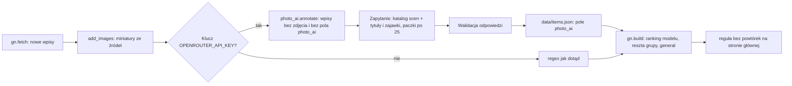

# Dobór ilustracji modelem AI (stan: 2026-11-24)

Stan: **zbudowane i przetestowane bez sieci; czeka na wgranie paczek i sekret `OPENROUTER_API_KEY`.**
Test na żywo 24.11 (Grodzisk, 44 wpisy): 44 odpowiedzi, 41 wyborów innych niż regex; ocena Marka: model
wyraźnie lepszy. Główne ograniczenie to wielkość puli — lista do dogenerowania: `05-rozbudowa-puli.md`.

## Decyzje (Marek, 23–24.11.2026)

| Temat | Decyzja |
|---|---|
| Wariant | C w jednym wywołaniu: model zwraca temat i ranking najwyżej 3 plików z tego tematu |
| Dostawca i model | OpenRouter, `anthropic/claude-haiku-5.5`; inny model: klucz `photo_ai_model` w `site.yaml` |
| Dane dla modelu | tylko numer w paczce, tytuł i zajawka wpisu |
| Temat wrażliwy (`none`) | karta bez zdjęcia z puli i bez rysowanej ilustracji (sama ikona kategorii) |
| Stare wpisy | klasyfikowane jednorazowo przy pierwszym przebiegu z kluczem (do 250 wpisów na przebieg) |
| Brakujące zdjęcia | model podaje pole `missing`; licznik na stronie `/zrodla/` |

Koszt z testu: 11 316 tokenów wejścia i 4 104 wyjścia na 44 wpisy, ok. 1,2 grosza (ceny z 23.11.2026:
0,10 USD i 0,50 USD za 1 mln tokenów). Szacunek dla trzech serwisów: poniżej 1 zł miesięcznie; po podwojeniu
puli prompt urośnie o ok. 2,5 tys. tokenów na wywołanie, co dodaje kilkadziesiąt groszy.

## Jak to działa



## Pliki

| Plik | Rola |
|---|---|
| `gn/photo_scenes.yaml` | katalog scen: opis grupy (`use`) i każdego pliku; scena działa, gdy jej plik jest w puli |
| `gn/photo_ai.py` | pula (`photo_pool`), prompt, wywołanie OpenRouter, walidacja, `annotate`, statystyka, raport |
| `gn/fetch.py` | po miniaturach woła `photo_ai.annotate`; wyjątek nie przerywa przebiegu |
| `gn/build.py` | `photo_candidates` bierze najpierw `picks`; `none` → bez zdjęcia; brak pola → regex |
| `templates/zrodla.html` | dwie linie pod tabelą: wpisy w grupach i najczęściej brakujące zdjęcia |
| `.github/workflows/build.yml` | sekret `OPENROUTER_API_KEY` w kroku „Pobierz źródła” |
| `tests/test_photo_ai.py` | testy bez sieci, w tym zgodność katalogu z plikami puli |

## Pole `photo_ai` przy wpisie

```json
{"topic": "police", "picks": ["police-4", "police-5"], "missing": "bike"}
```

| Wartość `topic` | Znaczenie | Skutek na stronie |
|---|---|---|
| nazwa grupy | wybór modelu | pierwszy wolny plik z `picks`, potem reszta grupy, potem `general` |
| `none` | temat wrażliwy | bez zdjęcia z puli |
| pusty tekst | model odpowiedział, ale pozycja była błędna | regex; wpis nie jest pytany ponownie |
| brak pola | wpis jeszcze nie oceniony albo błąd całej paczki | regex; pytanie w następnym przebiegu |

`picks` to nazwy plików bez rozszerzenia. Plik usunięty z puli jest pomijany. `missing` (1–3 słowa po angielsku)
pojawia się tylko wtedy, gdy żadna scena dobrze nie pasowała.

## Prompt

Stała `PROMPT` w `gn/photo_ai.py`; podgląd z aktualną pulą: `python -m gn.photo_ai --prompt`. Zasady:
- Temat według znaczenia, nie pojedynczych słów („dziki lokator” to nie dziki, „sesja zdjęciowa” to nie rada).
- `general`, gdy temat jest neutralny, ale nie pasuje do żadnej grupy.
- `picks` tylko z wybranej grupy, od najlepszego; mniej niż 3, gdy pozostałe sceny nie pasują wymową.
- `none` przy tematach wrażliwych: śmierć, pogrzeb, żałoba narodowa, wypadek z ofiarami, przemoc, przestępstwo
  wobec osoby, zaginięcie, krzywda dzieci, samobójstwo, ciężka choroba konkretnej osoby.

## Zabezpieczenia

- Odrzucane: numery spoza paczki, tematy spoza katalogu, pliki spoza wybranego tematu, duplikaty.
- Odpowiedź czytana pozycja po pozycji: z uciętej odpowiedzi zostają pełne pozycje.
- Błąd sieci lub modelu: komunikat w logu przebiegu, wpisy zostają przy regexie, pobieranie trwa dalej.
- Limit 10 wywołań na przebieg (`MAX_CALLS`). Limit kwotowy ustawia się na kluczu w OpenRouterze.
- Reguła „bez powtórek na stronie głównej” ma pierwszeństwo przed rankingiem modelu.

## Włączenie

1. OpenRouter: osobny klucz z limitem kwotowym.
2. GitHub, w każdym repo: Settings → Secrets and variables → Actions → New repository secret,
   nazwa `OPENROUTER_API_KEY`.
3. Wgrać paczkę z kodem. Pierwszy przebieg oceni stare wpisy; w logu kroku „Pobierz źródła” pojawi się linia
   „Dobór zdjęć AI (…): wpisów …, odpowiedzi …”.
4. Wyłączenie: usunąć sekret. Wyniki już zapisane zostają i dalej działają.

Po przeniesieniu pobierania na VPS klucz trafia do pliku środowiskowego na serwerze (`12-vps-plan-i-test-frog.md`).

## Rozbudowa puli

- Nowy obraz: plik `<grupa>-<numer>.jpg` w `static/img/topics-photo/` i linia opisu w `gn/photo_scenes.yaml`.
- Nowa grupa: nowy klucz w `gn/photo_scenes.yaml` (nazwa z samych małych liter) i pliki. Regex jej nie zna,
  więc działa tylko przez model.
- Wpisy ocenione wcześniej nie są pytane ponownie; z nowych obrazów korzystają nowe wpisy. Ponowna ocena
  wszystkich: usunąć pola `photo_ai` z `data/items.json`.
- Test ręczny i porównanie modeli: `python -m gn.photo_ai --compare 50 [--model <id>]`
  (raport `photo_ai_report.html`, poza repo dzięki `.gitignore`).
